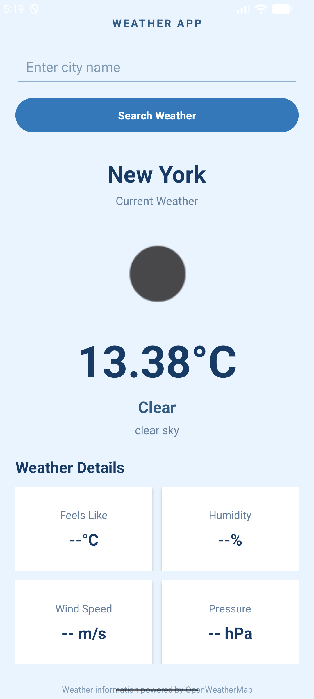
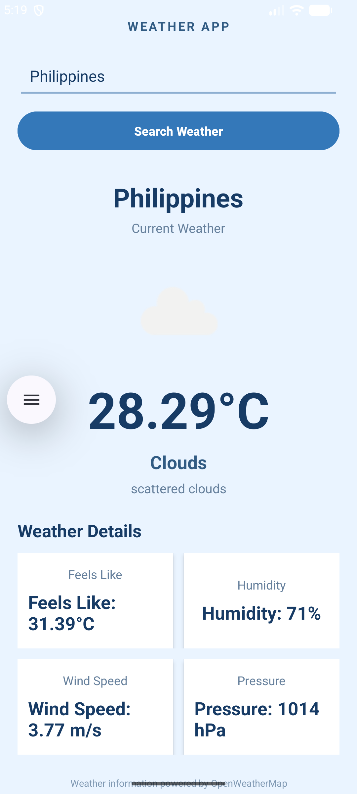
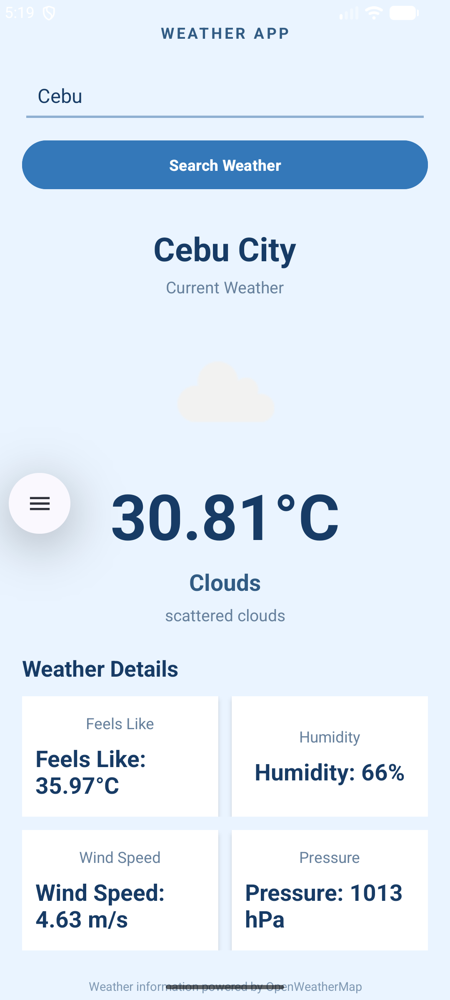

# 🌤️ WeatherApp

A simple and user-friendly Android weather application developed using **Kotlin** and **XML** in Android Studio. It allows users to search for a city and view its current weather information.

## 📱 Features

- **City Search** – Search for weather information by entering a city name.
- **Current Temperature** – Displays the current temperature of the selected city.
- **Weather Conditions** – Shows the weather description and corresponding weather icon.
- **Feels Like** – Displays the feels-like temperature.
- **Humidity** – Shows the current humidity percentage.
- **Wind Speed** – Displays the current wind speed.
- **Atmospheric Pressure** – Shows the current atmospheric pressure.
- **Dynamic Weather Icons** – Loads weather icons based on the current weather conditions.

## 🛠️ Technologies Used

- **Kotlin** – Main programming language.
- **XML** – Used to design the application interface.
- **Android Studio** – Development environment.
- **Retrofit** – Handles API requests.
- **Moshi** – Converts JSON responses into Kotlin objects.
- **Glide** – Loads weather icons from URLs.
- **OpenWeatherMap API** – Provides current weather information.

## 📸 Screenshots

### Home Screen


### Weather Information


### Search Results


## ⚙️ Installation and Setup

1. Clone this repository:

   ```bash
   git clone https://github.com/KristylPeyt/Weather_App.git
   ```

2. Open the project using **Android Studio**.

3. Get an API key from [OpenWeatherMap](https://openweathermap.org/api).

4. In the project root directory, open `local.properties` and add:

   ```properties
   OPENWEATHER_API_KEY=your_api_key_here
   ```

5. Sync the project with Gradle.

6. Run the application using an Android emulator or connected Android device.

**Note:** The `local.properties` file is excluded from Git tracking to keep the API key configuration private. Never upload your actual API key to GitHub.


---

⭐ If you find this project interesting, feel free to explore the repository!
